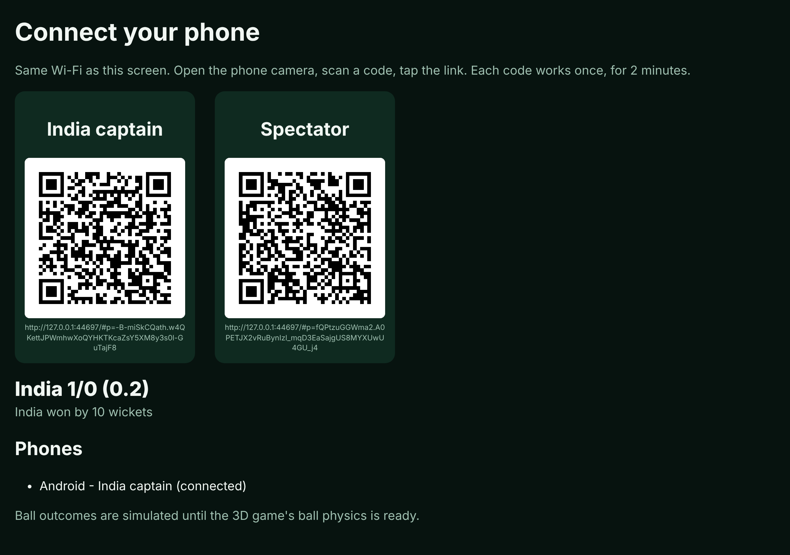

# Connect Your Phone to the Game

Your phone becomes the controller. You don't need to install anything.

## Steps

1. **Same Wi-Fi.** Connect your phone to the **same Wi-Fi** as the TV or PC
   running Cricket Unleashed. Turn off mobile data and any VPN on the phone.
2. **Open the QR code on the TV.** In the game, go to **Controllers**. A QR
   code appears for each team, plus one for spectators.
   *(Today's test program: run `cricket_controller_host`, scan the code it
   prints, or open `http://localhost:47321/tv` on the PC screen.)*
3. **Scan.** Open the phone's camera (or Google Lens) and point it at your
   team's code. Tap the link that pops up.
4. **Play.** The controller page opens and connects by itself. The dot at
   the top turns **green** and shows your team and role.

Each QR code works **once** and for **2 minutes**. The TV shows a new one
automatically.

## Playing

- **Your turn?** The phone vibrates and shows only the buttons you can use
  right now.
- **Bowling:** pick a delivery, tap the pitch where it should land, set the
  effort, press **BOWL**.
- **Batting:** when "Ball coming" appears, drag the half-circle to aim, then
  tap a shot **as the yellow bar fills**. Timing matters.
- **Captain:** choose openers, bowlers, the field and reviews. When a review
  is possible, a big **REVIEW** button with a countdown appears.
- Tap **⛶** for full screen.

## If something goes wrong

| What you see | What to do |
|---|---|
| "Reconnecting… (the TV is keeping your place)" | Wait a few seconds. The phone reconnects by itself, and the game waits for you. |
| The page doesn't open after scanning | The phone isn't on the same Wi-Fi, or the Wi-Fi is a **guest network** that blocks devices from seeing each other. Use the main Wi-Fi. |
| "Could not connect" / "pairing code expired" | Scan the **new** code on the TV. |
| Still can't connect, PC game | The PC firewall may be blocking the game. Allow `cricket_controller_host` (port **47321**) on *private* networks. |
| Wrong team on the phone | On the phone tap **Forget this TV and pair again**, then scan the right team's code. |
| Lost or borrowed phone | The TV can unpair any phone (the pairing list in the game). |

## Is it safe?

Yes for a home game. The secret inside the QR code never travels over the
Wi-Fi, and every button press is signed. Other people on your Wi-Fi can't
take control or fake button presses. (They could, in principle, see which
buttons you press. Details: [MOBILE_CONTROLLER.md](MOBILE_CONTROLLER.md).)
