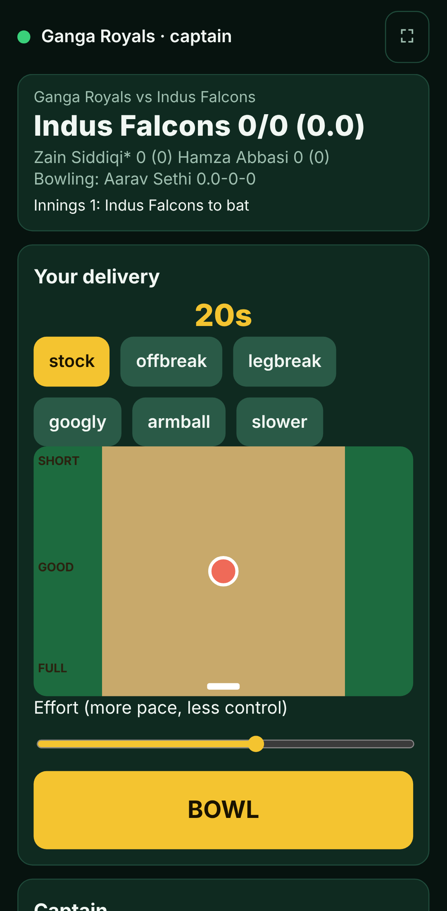
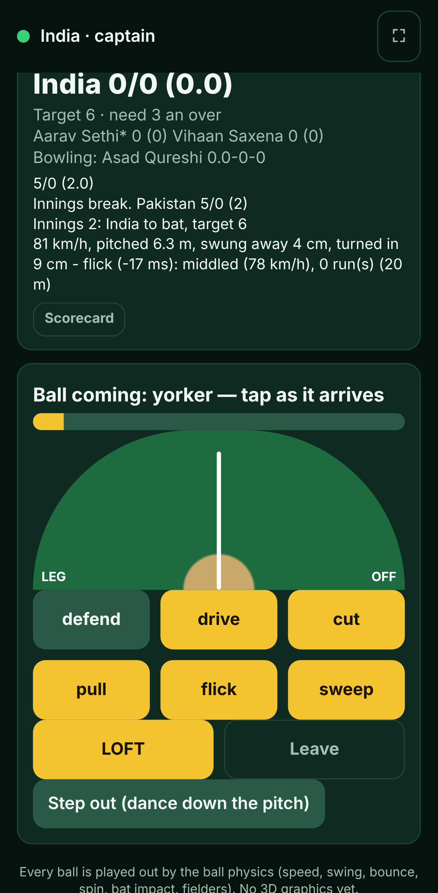

# Mobile Controller (Priority 2)

A phone becomes the game controller. Nothing is installed from an app store:
the phone opens a web page served by the TV/PC game over the home Wi-Fi.

 

## What is built

| Part | Code | What it does |
|---|---|---|
| Secure pairing hub | `controller/src/ControllerHub.cpp` | QR pairing, proof of the secret in both directions, device keys, signed and numbered messages, roles, reconnection, limits, revoking a phone |
| Match host | `controller/src/MatchHost.cpp` | turns phone controls into game actions, runs each ball in stages (bowl, then bat), sends each phone its own screen state |
| Local server | `controller/src/LocalServer.cpp` | small web server + WebSocket on the TV/PC (POSIX sockets) |
| QR codes | `controller/src/QrCode.cpp` | QR code generator (verified against two reference encoders) |
| Crypto | `controller/src/Crypto.cpp`, `controller/web/protocol.js` | SHA-256, HMAC-SHA256, SHA-1 (WebSocket handshake), base64. Checked against standard test vectors in both languages |
| Phone app | `controller/web/` | `protocol.js` (secure client), `app.js` (screens), `index.html`, `style.css` |
| TV/PC program | `tools/controller_host/main.cpp` → `cricket_controller_host` | runs a match, prints the QR code, serves the TV page (stands in for the Unreal game) |

Player instructions: [CONNECT_YOUR_PHONE.md](CONNECT_YOUR_PHONE.md).

## How a phone connects

```
TV/PC game                                   Phone (any modern browser)
──────────                                   ─────
1. makes a one-time pairing: id + 32-byte secret, valid 2 minutes
2. shows QR:  http://192.168.1.20:47321/#p=<id>.<secret>
                                     ──camera──►  3. opens the page; the part after '#'
                                                     is NEVER sent over the network
                                     ◄─────────   4. {"hello", id, phone nonce}
5. {"challenge", TV nonce}           ─────────►
                                     ◄─────────   6. proof = HMAC(secret, id|nonces)
7. checks proof, creates the device,
   {"welcome", TV proof}             ─────────►   8. checks the TV's proof (no fake TV)
   both sides compute (never send):
     device key  = HMAC(secret, "cu-device|"+device id)   - kept for reconnecting
     session key = HMAC(device key, both nonces)          - this connection only
9. every message both ways: {"m", number, body, HMAC(session key, direction|number|body)}
```

Reconnecting uses the same challenge with the saved **device key** instead of
the QR secret, so no new scan is needed. A new session key is made each time.

## Security model (honest)

**Protected against** (each has a test):
- Someone else on the Wi-Fi watching traffic **cannot pair or control** the
  game. The QR secret never crosses the network.
- **Forged, changed or replayed messages** are rejected, and that connection
  is closed. Every message is signed and numbered.
- A **copied or photographed QR code** is useless once used. It also expires
  after 2 minutes and is burned after 3 wrong attempts.
- **A fake "TV"** on the network can't fool the phone; the TV must prove it
  knows the secret too.
- **Other websites** open in the phone's browser can't talk to the TV.
  WebSockets are accepted only from the controller page's own origin.
- **The TV page** (it shows pairing secrets) is served only to the TV/PC
  itself, never to other devices.
- **Flooding / oversized messages / slow handshakes** are cut off, with
  limits on connections, devices, message size and message rate.
- **A refused action never runs twice**: each action has a number that
  survives reconnects (exactly-once).

**Not provided (by design, documented):**
- Messages are **authenticated, not encrypted**. Someone on the same Wi-Fi
  could *see* which buttons are pressed, but not fake them. Controller
  inputs aren't sensitive. HTTPS on a home network would need certificates
  that phone browsers warn about.
- The phone reports its own **shot timing**. That's fine for local play (it's
  your own phone). **Ranked online play must check timing on the server**;
  that's part of Priority 3.
- The saved **device list file** (`--devices`) contains device keys and
  must stay private on the TV/PC.

## Controls (role-based)

Every state the TV sends includes `controls`: the exact list this phone may
use right now. The phone only shows those buttons, and the TV rejects
anything else with a reason.

| Who | Controls |
|---|---|
| **Captain** (one team) | toss call / decision, openers, next batter, bowler, field preset, review / accept (with countdown), declare, follow-on, new ball, ready after a break, plus everything a player can do |
| **Player** (one team) | bowl (delivery type, tap-the-pitch line and length, effort), bat (shot, direction pad, timing tap, **step out** down the pitch), **fielding** when the ball goes to one of your fielders ("Catch it!" / "Stop it!" with a timing tap, throw to the keeper's or bowler's end), ready after a break |
| **Spectator** | watches the live score, no controls |

**Each ball:** the fielding side chooses the delivery (20 s, then a stock ball
is bowled for them). The batting phone shows the ball coming, and the player
taps a shot as it arrives; the timing is measured on the phone. No shot in
time → no shot played.

⚠️ **Placeholder outcomes:** there is no ball physics yet. The result of each
ball comes from the statistical simulator, nudged by the player's choices: a
leave can't be caught, defending gives no boundaries, good timing gives more
boundaries, and bad timing gives more catches. The phone and TV say so.
Unreal ball physics will replace this; the controls and protocol stay the
same.

## Status report (2026-11-21)

| Requirement (Priority 2) | Status | Tested by |
|---|---|---|
| QR-based pairing | done | C++ hub tests, Node protocol tests, Android-emulated browser test (QR scanned from the TV page) |
| Secure local Wi-Fi link | done: secret only in the QR, mutual proof, signed + numbered messages (authenticated, not encrypted) | hub tests incl. replay / forgery / wrong-secret cases |
| Batting controls | done: shot, direction, timing tap; **new: step out** | browser tests, `ctl_host_*` tests |
| Bowling controls | done: delivery type, line/length by tapping the pitch, effort | browser tests |
| Captaincy controls | done: toss, openers, batter, bowler, field preset, review/accept, declare, follow-on, new ball, ready | `ctl_host_role_based_controls` |
| **Fielding controls** | **completed now.** Before this milestone the phone's fielding buttons were sent but had no effect on the ball (a gap). Now the fielding side gets a prompt when the ball goes to a fielder; a well-timed CATCH / DIVE makes the catch or stop easier, a badly-timed one harder; THROW chooses the end for a run out | `ctl_host_fielding_prompt_step_out_scorecard_and_conditions`, single-player browser test |
| Reconnection | done: automatic, the game waits for a missing phone | hub, host and browser tests |
| Android browser support | done, **tested on emulated Pixel 7 only**, not on a physical phone | Playwright |
| Connection instructions | done: CONNECT_YOUR_PHONE.md, on-screen help | - |
| **Scorecard on the phone** | **new**: full card (batting R/B/4s/6s/SR, bowling O/M/R/W/Econ, extras, fall of wickets, partnerships) | browser test checks the numbers add up |
| **Match conditions on the phone** | **new**: pitch type and wear, wind, dew | host test |
| **Run / Wait calls** | **new (2026-11-21)**: when your batters hit the ball into the field, a **"Run?"** card shows where the ball is going, when the throw will reach the stumps, and how long your batters take for 1, 2, 3 runs. Tap **WAIT / 1 / 2 / 3**; the physics then decides if they make it (run out by a direct hit is possible). No tap before the countdown ends = the batters judge it themselves. Byes and leg byes are still run automatically | `ctl_host_run_wait_calls_from_the_phone`, `ctl_host_run_call_timeout_and_refusal`, two-phone and full-T20 browser tests |
| **Two phones, pairing + reconnection** | browser-tested (emulated): both pair, phone 2 Wi-Fi off → phone 1 sees "Waiting for the other team's phone" and the match waits, phone 2 returns to the same place, phone 1 reload keeps its pairing, same result on both | `controller/web/tests/two_phones.e2e.mjs` |
| **Plain-http address (like a real phone on Wi-Fi)** | tested: the page works when the browser does not treat it as "secure" | two-phone test |

Still missing: a test on **physical** phones (guide:
[ANDROID_PHONE_TESTING.md](ANDROID_PHONE_TESTING.md)).

## Reconnection

- The phone reconnects by itself (0.5 s → 8 s back-off) and when it comes back
  to the foreground. It shows "Reconnecting… (the TV is keeping your place)".
- The TV keeps the phone's team and role, re-sends the full screen state, and
  ignores actions that were already done (exactly-once).
- While **every phone of a human team is disconnected**, the TV **holds all
  timers** (bowling choice, batting window, review timer), so nobody loses a
  ball to a Wi-Fi blip. After 60 s the TV reports the phone as "lost" (the
  game can show a message). The phone can still come back.
- Closing the browser or reloading also resumes. The device key is saved on
  the phone.
- The TV can **unpair** a phone. Paired phones survive a TV restart with
  `--devices <file>`.

## Platform notes

- **Phones:** any current Android phone browser (Chrome, Samsung Internet,
  Firefox). Tested with Chromium emulating a Pixel 7 (see the test report).
  iPhones should work too (standard web APIs only) but have not been tested.
- **TV/PC side:** the server uses POSIX sockets: **Linux and Android** (Android
  TV) as written. **Windows** needs a small Winsock port of the socket calls
  in `LocalServer.cpp` (planned with the Unreal integration).
- Works offline: no internet, no cloud, nothing bought.

## How it plugs into Unreal later

`ControllerHub` and `MatchHost` have no networking or rendering inside. In
Unreal, a game-mode component will:
1. own a `ControllerHub` + `MatchHost` (or the game's own match driver),
2. run `LocalServer` (or bridge Unreal's sockets to `ControllerHub::Receive`),
3. render the QR code from `QrCode` on screen (the TV shows it in the lobby),
4. replace `MatchHost::ResolveWithInputs` with the physics result of the
   player's bat and ball inputs.

## Tests

- C++ (in `cricket_tests`): utilities 8, hub 14, match host 7, server 7
  (real sockets) = 36.
- JavaScript (`ctest` runs it): `controller/web/tests/protocol.test.mjs`.
  Hash vectors, link parsing, and end to end against the real host: two
  phones play a full India vs Pakistan match, a phone reconnects on its own,
  and used / forged QR codes are refused.
- Two phones: `node controller/web/tests/two_phones.e2e.mjs [screenshotDir]`
  (pairing, Wi-Fi drop and "waiting" screen, reload, run calls, same result
  on both phones, scorecard adds up; plain-http network address).
- Full T20 vs computer on one phone: `node online/web/tests/t20_full.e2e.mjs`
  (all 20 overs; every control; scorecard and result checked, then the
  server's saved match is replayed by `cricket_sim --verify`).
- Browser: `node controller/web/tests/browser.e2e.mjs [screenshotDir]`.
  Chromium emulating an Android Pixel 7 taps through the real page: pairing,
  bowling, batting, the reconnect message, resume after reload, no
  JavaScript errors, and the TV QR code decodes to its link (with
  `CU_JSQR_DIR` pointing at a folder with `jsqr` + `pngjs`, development
  only).
